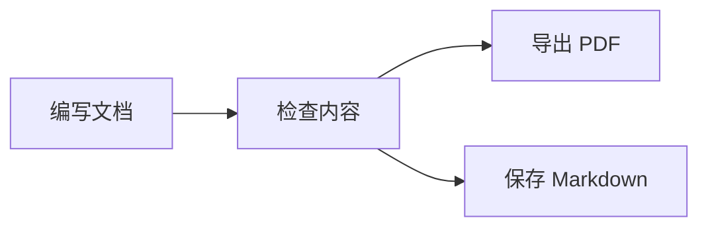

# Muffin 开发笔记

用 Markdown 整理项目文档、代码片段和发布计划。

## 编辑器

直接在页面上编辑，或切换到 Markdown 源码。文档保存为本地 `.md` 文件。

| 内容           | 支持     |
| -------------- | -------- |
| 表格与任务列表 | 直接编辑 |
| 代码块         | 语法高亮 |
| 数学公式       | LaTeX    |
| 图表           | Mermaid  |

## 构建

```cpp
#include <iostream>

int main() {
    std::cout << "Hello, Muffin!";
    return 0;
}
```

## 发布流程



## 数学公式

$$
e^{i\pi} + 1 = 0
$$
