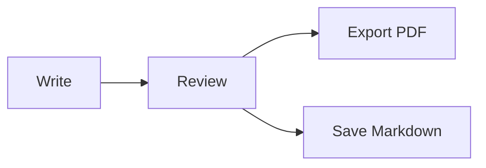

# Muffin development notes

Project documentation, code snippets and release plans in one Markdown file.

## Editor

Edit the formatted document or switch to Markdown source. Save your work as a local `.md` file.

| Content          | Support             |
| ---------------- | ------------------- |
| Tables and tasks | Direct editing      |
| Code blocks      | Syntax highlighting |
| Equations        | LaTeX               |
| Diagrams         | Mermaid             |

## Build

```cpp
#include <iostream>

int main() {
    std::cout << "Hello, Muffin!";
    return 0;
}
```

## Release workflow



## Equations

$$
e^{i\pi} + 1 = 0
$$
